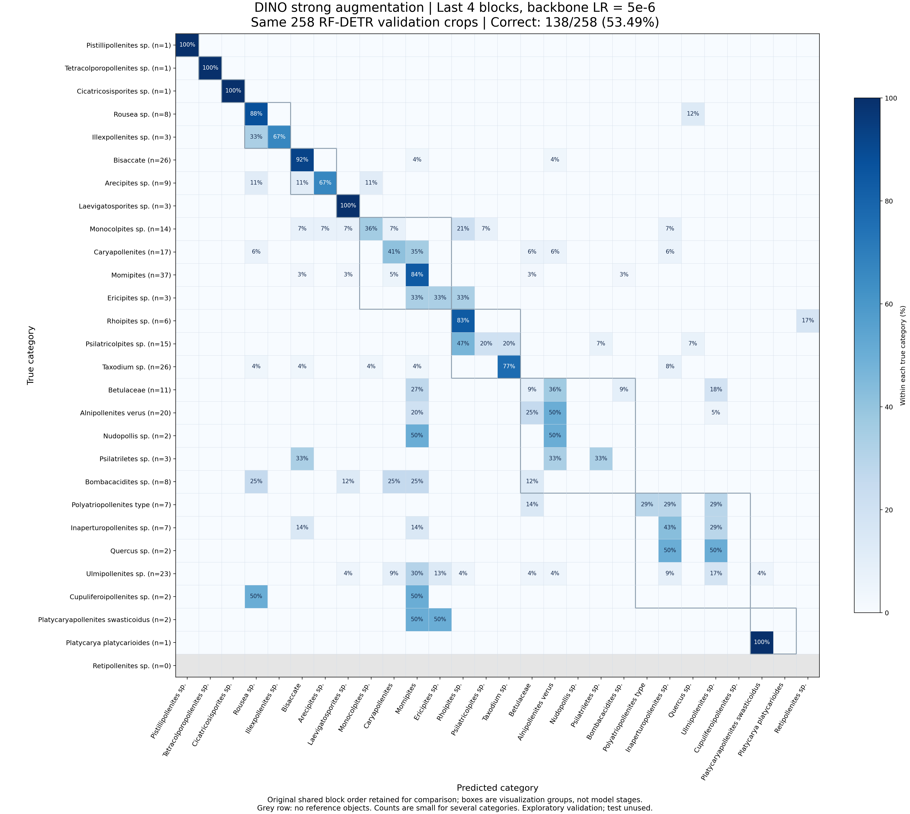

# DINO strong augmentation: last-two vs last-four blocks

Review figures and compact prediction tables for the same 258 matched RF-DETR validation crops. New model: strong augmentation, final four blocks and final norm/head trainable, backbone LR 5e-6. Comparator: strong augmentation, final two blocks, backbone LR 1e-5. This is a combined depth-and-LR change, not a depth-only ablation.

[Training code, protocol, provenance and NOTS locations](../../scripts/classification/dino_strong_four_layers/README.md).

## Confusion matrices

- [Row-normalized PNG](four_layers_confusion_normalized.png) / [PDF](four_layers_confusion_normalized.pdf)
- [Counts PNG](four_layers_confusion_counts.png) / [PDF](four_layers_confusion_counts.pdf)
- [Counts CSV](four_layers_confusion_counts.csv)
- [Row-percentage CSV](four_layers_confusion_row_percent.csv)

Rows are true categories; columns are predicted categories. Both axes retain the earlier shared block order for comparison; outlined blocks are visual groups, not model stages or new biological groupings. The grey Retipollenites row has no references. Small-support categories can show 100% based on one specimen.

## Statistics and object-level changes

- [All 28 categories: support, TP/FP/FN, precision, recall, F1, AP and changes](four_layers_per_class_statistics.csv)
- [All 258 objects: reference, both predictions and outcome](two_vs_four_object_comparison.csv)

Per-class precision/recall/F1/AP are fractions from 0 to 1, not percentages; unsupported recall/F1/AP are blank. A category's correct count can remain unchanged even if different specimens become correct. `newly_correct` means last-two wrong and last-four correct; `newly_wrong` means the reverse. Both-wrong specimens may still change predicted labels.

| Outcome | Objects |
|---|---:|
| Both correct | 115 |
| Last-two wrong, last-four correct | 23 |
| Last-two correct, last-four wrong | 18 |
| Both wrong | 102 |
| Total | 258 |

Correct count: 133 -> 138 (net +5). Last-four accuracy 53.49%, supported-class macro precision 48.63%, macro recall 46.99%, macro-F1 44.52%, classification macro-AP 52.65%. Changes in prediction labels: 73 objects. No detector rerun; RGB tile/crop hashes matched. The classifier has 28 outputs; macro metrics include the 27 supported reference classes.

**Scope:** exploratory, single-seed validation, not independent test. The original detector saw 13/14 evaluation slides. These tables exclude the 16 undetected references; including them, joint success is 138/274 (50.36%). They do not describe all specimens in the dataset. No raw specimen images, crop pixels, full score tensors or weights are uploaded; PNG/PDF files are analytical charts. The compact per-object comparison CSV is included at the user's explicit request.
