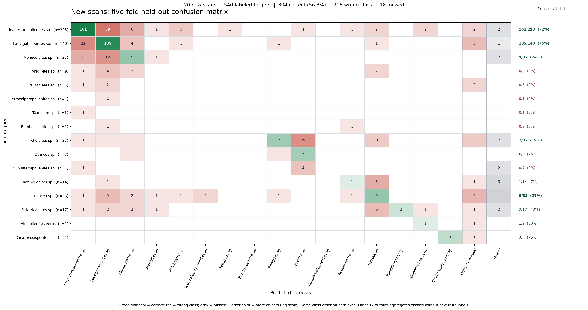

# Method A4 on the November training delivery

## Data and training

The November `New_train_set_detection_model_rice` delivery supplied 540 in-bounds sponsor-priority YES objects across 20 distinct scans and 16 sponsor categories. Original labels were mapped through the established 32-to-28 category mapping. NO, MAYBE, blank, and unmapped source titles were excluded from positive class labels. The preparation exported 535 annotation-centered context crops with LoG k=5 fusion. The resulting training COCO combined these crops with the 1,423 historical A3 training images: 1,958 images and 2,311 known box instances in 28 merged classes. An A4 one-class detector pass added 3,188 pseudo ignore boxes around unlabeled pollen candidates.

RF-DETR 2XL was initialized from the Spring one-class checkpoint and trained with the A4 ignore-region loss and flip/rotation augmentation. Input size was 1,000 px; batch size was 1 with gradient accumulation of 16; seed was 20261013. The full-data run and each fold run used 2,400 optimizer steps and the fixed final EMA checkpoint, without validation-based checkpoint selection. Full-data checkpoint SHA-256: `2fd94d63e5f3bcb58b92d5503217ff2cc11aca7774edce89de7c07c9f9912b30`. Training COCO SHA-256: `ed766c691ae1a6b45e930ee6df9063c69a78a75fc6f4703a06a362e1d908a72d`.

## Held-out evaluation

The 20 new scans were partitioned into five disjoint folds of four whole scans. Each fold model trained on the 1,423 historical training images plus the other 16 new scans, then evaluated its four held-out new scans. Every new scan contributed predictions exactly once. Fold training used time-limited Lightning resume chunks to reach the fixed 2,400-step budget.

Predictions were mapped from padded crop coordinates to slide coordinates, merged across crops with class-agnostic NMS at IoU 0.50, and matched one-to-one against unique known objects at IoU >= 0.50. Confidence candidates were 0.25, 0.30, 0.40, 0.50, and 0.75. Mean held-out-scan correct-location-and-class rate selected the threshold; micro rate and then the higher threshold broke ties. The selected confidence was **0.30**. Thresholds 0.25 and 0.30 both yielded 304 correct objects and the same mean scan rate.

| Fold | Held-out scans | Known objects | Detected | Correct location and class |
| ---: | ---: | ---: | ---: | ---: |
| 0 | 4 | 164 | 163 | 116 |
| 1 | 4 | 94 | 84 | 27 |
| 2 | 4 | 94 | 89 | 45 |
| 3 | 4 | 98 | 96 | 63 |
| 4 | 4 | 90 | 90 | 53 |
| **Pooled** | **20** | **540** | **522 (96.7%)** | **304 (56.3%)** |

Of 540 known targets, 304 were localized and classified correctly, 218 were detected with the wrong class, and 18 were missed. The mean of the 20 scan-level correct rates was 48.1%. The 16 classes present in the new positive labels provide no direct estimate for the other 12 model classes. These are annotation-guided positive-context-crop results: unmatched predictions were not adjudicated, and the numbers do not measure whole-slide search or full-scene precision. The delivery contains no separate labeled new-data test split. The pooled five-fold result is an out-of-fold assessment; the confidence threshold was chosen on those same folds.

## Confusion matrix

Rows are true classes and columns are predicted classes. The same 16-class order is used on both axes, placing correct classifications on the green diagonal. Red cells show wrong-class predictions, gray cells show missed objects, and printed numbers are object counts. Darker color represents more objects on a log scale. The display places the main observed confusion groups together: Inaperturopollenites/Laevigatosporites/Monocolpites, Rhoipites/Quercus/Cupuliferoipollenites, and Retipollenites/Rousea/Psilatricolpites. The `Other 12 outputs` column combines model classes without new ground-truth support for display. [The full count matrix](confusion_counts.csv) retains all 28 predicted classes plus missed objects.

The largest directed confusions were Inaperturopollenites to Laevigatosporites (39), the reverse (22), Rhoipites to Quercus (19), and Monocolpites to Laevigatosporites (17). Inaperturopollenites and Laevigatosporites accounted for 363/540 known targets and 266/304 correct outcomes. The remaining classes collectively had 38/177 correct (21.5%).

## Reproduction records

The [workflow code and run order](../../scripts/method_a_new_delivery/README.md) and [versioned label maps](../../data/current/new_delivery_maps/README.md) are included in this PR. Training data and fold manifests: `/rhf/allocations/dsci435/Smithsonian_F26/processed/method_a_new_delivery/training/`. Preparation code, run logs, per-object matches, predictions, and source count JSON: `/projects/dsci435/Smithsonian_F26/method_a/new_delivery/`. Checkpoints: `/rhf/allocations/dsci435/Smithsonian_F26/model_A/runs/A4_new_delivery_20261113/`. The training implementation follows the A4 source at [`8174c47`](https://github.com/PatrickBats/Smithsonian_fossil_F26/tree/8174c47939430d873a4f42b023f35fe7516aa168/scripts/method_a_ignore_regions), with the executed configuration retained in this PR.
